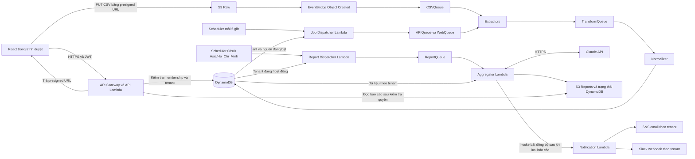

# MarketData Pipeline

> Backend dùng Python/SAM, giao diện dùng React. Bản hợp nhất ngày 04/11/2026 nhận Notification Lambda riêng, retry từng kênh, cấu hình nguồn qua UI và ID quan sát theo nội dung. Phần của Hoàng bổ sung transaction membership, kiểm tra đích gửi theo tenant và đọc secret bằng ARN. Kết quả AWS ngày 01/11 và trạng thái kiểm thử bản hợp nhất nằm trong [bàn giao của Hoàng](docs/hoang-final-handover.md).

MarketData Pipeline là phần mềm cung cấp qua trình duyệt theo mô hình dịch vụ, giúp doanh nghiệp bán lẻ và thương mại điện tử gom, chuẩn hóa và so sánh giá từ file CSV, REST API và trang HTML được phép thu thập.

## Mục tiêu MVP

- Tài khoản, tenant doanh nghiệp, thành viên và các vai trò Admin, Analyst, Viewer.
- Nhận dữ liệu CSV, một API mẫu và một trang HTML tĩnh được phép thu thập.
- Chuẩn hóa sản phẩm, SKU, đơn vị tiền và thời điểm quan sát; giữ lịch sử giá tối đa 30 ngày.
- Dashboard hiển thị so sánh giá, nguồn lỗi hoặc dữ liệu cũ, và các SKU cần người dùng xác nhận.
- Báo cáo AI hằng ngày có dữ liệu dẫn chứng và giới hạn rõ ràng; AI hỗ trợ xem xét, không tự đổi giá.
- Dùng thử với hai tenant để kiểm tra quyền và cách ly dữ liệu.

Hạn mức Pilot trong tài liệu thiết kế: tối đa 100 SKU, 3 nguồn và 5 người dùng trên mỗi tenant. Thanh toán trực tuyến, scraper cho website động và điều chỉnh giá tự động nằm ngoài MVP.

## Trạng thái hiện tại

- Phần hạ tầng và chuẩn hóa của Hoàng: code tại `marketdata/`, `services/normalizer/`, SAM template tại `infra/aws/template.yaml`. Xem [hướng dẫn chạy và bàn giao của Hoàng](docs/hoang-handover.md).
- Phần Ingestion: CSV worker do Hoàng thêm làm adapter tham chiếu; Hướng triển khai API và Web HTML workers. Cả ba luồng dùng contract chung và có fixtures/test tích hợp. Xem [hướng dẫn bàn giao của Hướng](docs/huong-handover.md).
- Lộ trình 5 tuần vẫn là kế hoạch của cả nhóm; không coi kết quả giả lập là đã triển khai toàn bộ hệ thống.

## Cấu trúc

```text
.
├── .github/                 # Mẫu issue và pull request
├── apps/web/                # Ứng dụng trình duyệt
├── docs/                    # Kiến trúc, hợp đồng dữ liệu, kế hoạch và ADR
├── infra/aws/               # Template hạ tầng AWS
└── services/
    ├── api/                 # API, xác thực quyền và quota
    ├── ingestion/            # Nhận file và thu thập nguồn
    ├── normalizer/           # Kiểm tra, ghép SKU, chuẩn hóa giá
    └── reporting/            # Tổng hợp, báo cáo và thông báo
```

## Luồng dữ liệu dự kiến




Đây là kiến trúc dự kiến trong báo cáo. Chi tiết ở [architecture.md](docs/architecture.md) và [data-contract.md](docs/data-contract.md). Phân công và bảng 576 giờ theo bản đã nộp ở [team-work-split.md](docs/team-work-split.md); Hoàng phụ trách chính hạ tầng AWS/IAM, chuẩn hóa và kiểm tra cách ly dữ liệu. Mỗi thành viên được phân bổ 144 giờ.

## Chạy frontend

Xem [apps/web/README.md](apps/web/README.md): `cd apps/web && pnpm install && pnpm dev`, kiểm thử bằng `pnpm test`.

## Chạy phần của Hoàng

Dùng Python 3.12, từ thư mục gốc:

```powershell
python -m venv .venv
.venv\Scripts\python.exe -m pip install -r requirements-dev.lock.txt
.venv\Scripts\python.exe -m pytest -q
.venv\Scripts\ruff.exe check .
.venv\Scripts\cfn-lint.exe infra/aws/template.yaml
.venv\Scripts\python.exe -m scripts.demo
.venv\Scripts\python.exe -m scripts.demo_ingestion
```

Demo dùng Moto, không gọi tài khoản AWS thật. Fixture 100 dòng được chạy lại hai lần: 90 quan sát hợp lệ, 10 dòng lỗi, không tăng số quan sát và không xuất hiện ở tenant khác.

`scripts.demo_ingestion` trình diễn REST API và HTML worker bằng fixtures, gửi kết quả sang Normalizer, chạy lặp để kiểm tra idempotency và xác nhận tenant B không nhận dữ liệu.

Chi tiết contract, quyền và phần bàn giao nằm trong [hoang-handover.md](docs/hoang-handover.md). Hướng dẫn chuẩn bị triển khai ở [infra/aws/README.md](infra/aws/README.md). Không có route HTTP giả hoặc API key mẫu cho Claude/Slack.

Không commit API key, webhook, credentials hoặc dữ liệu khách hàng. Xem [CONTRIBUTING.md](CONTRIBUTING.md) và [SECURITY.md](SECURITY.md).
