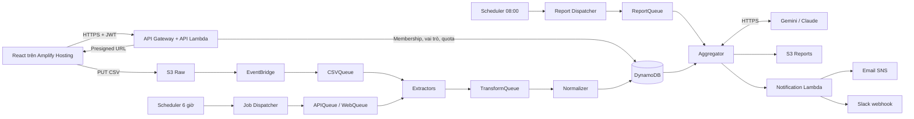

# MarketData Pipeline: Phần mềm theo dõi giá đa nguồn và phân tích thị trường
*(Multi-source Price Tracking and Market Analysis SaaS on AWS)*

[](https://www.python.org/)
[](https://react.dev/)
[](https://aws.amazon.com/serverless/sam/)
[](#)
[](#)

> **Môn học:** Điện toán đám mây (2627I_INT3319_1)  
> **Giảng viên hướng dẫn:** Hoàng Xuân Tùng  
> **Nhóm thực hiện:** Nhóm 07 

| STT | Thành viên | MSSV | Vai trò chính |
| :---: | :--- | :---: | :--- |
| 1 | Ngô Nguyễn Nhật Minh (*Nhóm trưởng*) | 24021566 | Yêu cầu, giao diện React, tích hợp và vận hành môi trường nhóm |
| 2 | Phạm Văn Hướng | 24021510 | Thu thập dữ liệu: CSV, REST API, website; trạng thái nguồn và xử lý lỗi |
| 3 | Vũ Minh Hoàng | 24021494 | Hạ tầng AWS/SAM, IAM, chuẩn hóa dữ liệu, cách ly tenant, kiểm thử và giám sát |
| 4 | Đỗ Huy Hiếu | 24021470 | Đăng nhập, membership/RBAC, quota, báo cáo AI và thông báo |

---

## 1. THÔNG TIN TỔNG QUAN ĐỀ TÀI

### 1.1 Tên đề tài
- **Tiếng Việt:** MarketData Pipeline, phần mềm theo dõi giá đa nguồn và phân tích thị trường.
- **Tiếng Anh:** MarketData Pipeline, a multi-source price tracking and market analysis SaaS.

### 1.2 Bài toán đặt ra
Doanh nghiệp bán lẻ và thương mại điện tử cần so sánh giá của nhà cung cấp và đối thủ. Báo giá lại nằm rải rác trong file CSV, JSON từ API và trang HTML, mỗi nơi đặt tên sản phẩm một kiểu. Người phụ trách phải tự xác định đúng sản phẩm, kiểm tra thời điểm cập nhật rồi mới ghép các mức giá để so sánh. Sai mã hàng, khác dung lượng hay thiếu thông tin thuế đều có thể tạo ra chênh lệch giá không có ý nghĩa.

MarketData Pipeline là phần mềm cung cấp dưới dạng dịch vụ (SaaS) giúp gom, chuẩn hóa và so sánh giá từ nhiều nguồn, để chuyên viên chọn nguồn mua và phát hiện mức giá cần xem xét. Khách hàng dùng phần mềm qua trình duyệt, không cần tự quản lý hạ tầng AWS.

### 1.3 Điểm nổi bật & Giải pháp
- **Đa người thuê (multi-tenant) và cách ly dữ liệu:** Mỗi doanh nghiệp là một workspace riêng với ba vai trò Admin, Analyst, Viewer. `tenant_id` luôn lấy từ danh tính đã xác thực (Cognito + JWT), không bao giờ lấy từ CSV hay request do người dùng gửi.
- **Thu thập đa nguồn:** Nhận file CSV (tải thẳng lên S3 bằng presigned URL), REST API và website bán lẻ được phép thu thập (Fahasa, Kim Đồng, storefront Haravan/Shopify). Nguồn API và web chạy theo lịch mỗi 6 giờ hoặc ngay khi người dùng yêu cầu.
- **Chuẩn hóa và ghép SKU có kiểm soát:** Normalizer chuẩn hóa mã sản phẩm, tiền tệ, thời điểm quan sát, chống ghi trùng khi xử lý lại (idempotent). Các ghép chưa chắc chắn chờ Analyst duyệt trong Catalog.
- **Dashboard và báo cáo AI:** Ma trận giá 24 giờ theo nguồn, đánh dấu chênh lệch từ 15%, lịch sử 30 ngày. Mỗi ngày lúc 08:00 (Asia/Ho_Chi_Minh) hệ thống tổng hợp dữ liệu và dùng Gemini hoặc Claude viết nhận định, gửi thông báo qua email (SNS) hoặc Slack. AI chỉ hỗ trợ xem xét, không tự đổi giá.
- **Serverless, hướng sự kiện, chịu lỗi:** API Gateway, Lambda, SQS (mỗi hàng đợi có DLQ riêng), EventBridge, DynamoDB, S3. Lỗi ở một nguồn hay ở bước AI không làm dừng các phần khác.
- **Kiểm soát chi phí:** Stack `demo-guard` tạo AWS Budget 10 USD, gửi email khi vượt 5 USD và tự tạm dừng hệ thống khi vượt 8 USD.

Gói Pilot: mỗi tenant tối đa 100 SKU, 3 nguồn, 5 người dùng và 1 báo cáo AI mỗi ngày, kiểm tra phía máy chủ.

### 1.4 Kiến trúc hệ thống



Chi tiết ở [docs/architecture.md](docs/architecture.md) và [docs/data-contract.md](docs/data-contract.md).

### 1.5 Sản phẩm bàn giao

| Hạng mục | Đường dẫn |
| :--- | :--- |
| Ứng dụng web đang chạy | <https://main.d1v1jrtzpab44p.amplifyapp.com> |
| Mã nguồn | <https://github.com/minhngo123456/DataMarket-Pipeline> |
| Môi trường AWS | Stack `marketdata-dev`, Region `ap-southeast-1` (Singapore) |
| Hạ tầng dưới dạng mã | `infra/aws/template.yaml`, `tenant-notifications.yaml`, `demo-guard.yaml` |
| Trạng thái triển khai và kiểm thử | [docs/deployment-status.md](docs/deployment-status.md), [docs/hoang-final-handover.md](docs/hoang-final-handover.md) |

---

## 2. HƯỚNG DẪN CÀI ĐẶT MÔI TRƯỜNG PHÁT TRIỂN

### 2.1 Yêu cầu hệ thống
- **Hệ điều hành:** Windows 10/11 (môi trường của nhóm), macOS hoặc Linux.
- **Công cụ:**
  - Python **3.12** (backend và kiểm thử).
  - Node.js **22** (tối thiểu 18) và `pnpm` (frontend).
  - Git.
- **Chỉ cần khi triển khai lên AWS:** tài khoản AWS, AWS CLI v2, AWS SAM CLI.

Kiểm thử cục bộ dùng Moto giả lập AWS, **không** cần tài khoản AWS thật.

---

### 2.2 Tạo môi trường ảo và cài đặt dự án

#### Bước 1: Tải mã nguồn về máy
```bash
git clone https://github.com/minhngo123456/DataMarket-Pipeline.git
cd DataMarket-Pipeline
```

#### Bước 2: Tạo và kích hoạt môi trường ảo (Virtual Environment)
- **Trên Windows (PowerShell):**
  ```powershell
  python -m venv .venv
  .\.venv\Scripts\Activate.ps1
  ```
  *(Nếu gặp chính sách bảo mật Script Execution, chạy lệnh: `Set-ExecutionPolicy RemoteSigned -Scope CurrentUser`)*

- **Trên Windows (Command Prompt):**
  ```cmd
  python -m venv .venv
  .venv\Scripts\activate.bat
  ```

- **Trên macOS / Linux:**
  ```bash
  python3 -m venv .venv
  source .venv/bin/activate
  ```

---

### 2.3 Cài đặt các thư viện phụ thuộc

#### Backend (Python)
Sau khi kích hoạt `.venv`, nâng cấp `pip` và cài đặt bản đã khóa phiên bản:

```bash
python -m pip install --upgrade pip
pip install -r requirements-dev.lock.txt
```

#### Frontend (React)
```bash
cd apps/web
pnpm install --frozen-lockfile
cp .env.example .env.local   # điền giá trị Cognito và API
cd ../..
```

#### Các thư viện công nghệ chủ chốt:
| Thư viện | Phiên bản | Vai trò trong hệ thống |
| :--- | :--- | :--- |
| `boto3` | `1.43.114` | Gọi các dịch vụ AWS (DynamoDB, S3, SQS, SNS, Secrets Manager) từ Lambda |
| `tzdata` | `2026.5` | Múi giờ Asia/Ho_Chi_Minh khi chuẩn hóa và hiển thị thời gian |
| `pytest`, `moto` | `8.x`, `5.x` | Kiểm thử tự động, giả lập AWS cục bộ |
| `ruff` | `0.x` | Kiểm tra chuẩn code Python |
| `cfn-lint`, `aws-sam-translator` | `1.x` | Kiểm tra và dịch template SAM/CloudFormation |
| `react`, `vite` | `19.x`, `8.x` | Ứng dụng web và công cụ build |
| `antd`, `recharts` | `6.x`, `3.x` | Giao diện, ma trận giá và biểu đồ lịch sử giá |
| `aws-amplify`, `@aws-amplify/ui-react` | `6.x` | Đăng nhập Cognito trên trình duyệt |
| `axios`, `papaparse` | `1.x`, `5.x` | Gọi HTTP API, xem trước file CSV trước khi tải lên |
| `vitest`, `@testing-library/react` | `5.x`, `16.x` | Kiểm thử giao diện |

---

### 2.4 Kiểm tra môi trường hoạt động

Chạy bộ kiểm thử và hai kịch bản demo (dùng Moto, không gọi AWS thật):

```bash
python -m pytest -q
ruff check .
cfn-lint infra/aws/template.yaml infra/aws/tenant-notifications.yaml
python -m scripts.demo             # CSV 100 dòng: 90 accepted / 10 rejected, tenant B có 0 quan sát
python -m scripts.demo_ingestion   # API + web: tenant A 6 quan sát, tenant B 0
```

Kiểm thử giao diện và chạy web cục bộ:
```bash
cd apps/web
pnpm test
pnpm dev                           # http://localhost:5173
```

Kết quả chạy lại ngày 14/11/2026: **679** kiểm thử pytest và **70** kiểm thử Vitest đều đạt, `ruff` và `cfn-lint` không báo lỗi.

---

### 2.5 Triển khai lên AWS

Quy trình 12 bước (chuẩn bị công cụ, tạo secret khóa AI, `sam build`, `sam deploy`, đưa web lên Amplify, tạo tenant, kiểm thử, bật lịch và bảo vệ chi phí) nằm trong [infra/aws/README.md](infra/aws/README.md) và [docs/aws-deploy-free-plan.md](docs/aws-deploy-free-plan.md). Tóm tắt:

```powershell
python -m scripts.stage_lambda
python -m scripts.validate_template
sam build --template-file infra/aws/template.yaml
sam deploy --guided --profile marketdata-dev --region ap-southeast-1 --stack-name marketdata-dev --capabilities CAPABILITY_IAM --parameter-overrides ScheduleState=DISABLED EnableCloudFront=DISABLED GeminiSecretArn=<ARN> ...
```

Khóa AI và webhook Slack lưu trong Secrets Manager. Không commit API key, webhook, credentials hoặc dữ liệu khách hàng (xem [CONTRIBUTING.md](CONTRIBUTING.md), [SECURITY.md](SECURITY.md)).

---

### 2.6 Cấu trúc thư mục

```text
DataMarket-Pipeline/
├── .github/              # CI (pytest, ruff, cfn-lint), mẫu issue và pull request
├── apps/web/             # Ứng dụng React + Vite (6 trang: Dashboard, Nguồn, Upload, Catalog, Báo cáo, Thành viên)
├── docs/                 # Kiến trúc, hợp đồng dữ liệu/API, phân công, bàn giao, ADR
├── infra/aws/            # Template SAM: stack chính, thông báo theo tenant, bảo vệ chi phí
├── marketdata/           # Thư viện lõi: contract, chuẩn hóa, repository DynamoDB, phân quyền
├── services/
│   ├── api/              # HTTP API: xác thực, RBAC, quota, các route
│   ├── ingestion/        # CSV, REST API, web worker và dispatcher
│   ├── normalizer/       # Kiểm tra, ghép SKU, ghi quan sát giá
│   ├── reporting/        # Tổng hợp, báo cáo AI và thông báo
│   └── demo_guard/       # Tạm dừng hệ thống khi vượt ngân sách
├── scripts/              # Demo, đóng gói Lambda, kiểm tra và kiểm thử trên AWS
├── tests/                # Kiểm thử pytest + Moto và fixtures
├── requirements.txt
└── requirements-dev.lock.txt
```
