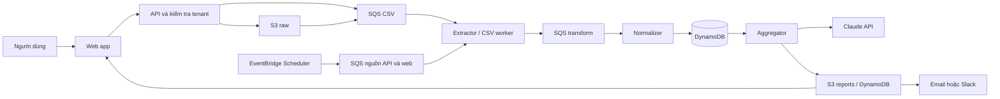

# MarketData Pipeline

> **Trạng thái:** bộ khung repo và thiết kế MVP. Phần mềm chưa được triển khai trong gói này.

MarketData Pipeline hướng tới một SaaS giúp doanh nghiệp bán lẻ và thương mại điện tử gom, chuẩn hóa và so sánh giá từ file CSV, REST API và trang HTML được phép thu thập.

## Mục tiêu MVP

- Tài khoản, tenant doanh nghiệp, thành viên và các vai trò Admin, Analyst, Viewer.
- Nhận dữ liệu CSV, một API mẫu và một trang HTML tĩnh được phép thu thập.
- Chuẩn hóa sản phẩm, SKU, đơn vị tiền và thời điểm quan sát; giữ lịch sử giá tối đa 30 ngày.
- Dashboard hiển thị so sánh giá, nguồn lỗi hoặc dữ liệu cũ, và các SKU cần người dùng xác nhận.
- Báo cáo AI hằng ngày có dữ liệu dẫn chứng và giới hạn rõ ràng; AI hỗ trợ xem xét, không tự đổi giá.
- Dùng thử với hai tenant để kiểm tra quyền và cách ly dữ liệu.

Hạn mức Pilot trong tài liệu thiết kế: tối đa 100 SKU, 3 nguồn và 5 người dùng trên mỗi tenant. Thanh toán trực tuyến, scraper cho website động và điều chỉnh giá tự động nằm ngoài MVP.

## Trạng thái hiện tại

Repo này mới là điểm bắt đầu: tài liệu kiến trúc và quy trình GitHub đã được chuẩn bị; mã ứng dụng, hạ tầng và kiểm thử chưa được tạo. Lộ trình trong `docs/roadmap.md` là kế hoạch dự kiến, không phải báo cáo tiến độ hoàn thành.

## Cấu trúc

```text
.
├── .github/                 # Mẫu issue và pull request
├── apps/web/                # Ứng dụng trình duyệt
├── docs/                    # Kiến trúc, hợp đồng dữ liệu, kế hoạch và ADR
├── infra/aws/               # Hạ tầng AWS dự kiến
└── services/
    ├── api/                 # API, xác thực quyền và quota
    ├── ingestion/            # Nhận file và thu thập nguồn
    ├── normalizer/           # Kiểm tra, ghép SKU, chuẩn hóa giá
    └── reporting/            # Tổng hợp, báo cáo và thông báo
```

## Luồng dữ liệu dự kiến



Đây là kiến trúc dự kiến trong báo cáo. Chi tiết ở [architecture.md](docs/architecture.md) và [data-contract.md](docs/data-contract.md).

## Bắt đầu phát triển

Chưa có runtime, dependency hay lệnh chạy ứng dụng được chốt. Trước khi viết code, nhóm nên thống nhất ngôn ngữ cho Lambda, công cụ quản lý hạ tầng, schema job/observation và cách chạy cục bộ. Sau đó cập nhật README này với các lệnh cài đặt, cấu hình và chạy thật.

Không commit API key, webhook, credentials hoặc dữ liệu khách hàng. Xem [CONTRIBUTING.md](CONTRIBUTING.md) và [SECURITY.md](SECURITY.md).
